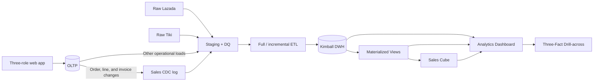

# QuocDat Marketplace Architecture

## 1. End-to-end flow

- Raw files are never modified; they are read and standardized into Staging.
- The web application writes operational transactions to OLTP in real time.
- ETL integrates marketplace snapshot history with confirmed OLTP transactions.
- The DWH uses surrogate keys, conformed dimensions, and facts with explicit grains.
- Every successful ETL run refreshes four physical Materialized Views and the Sales Cube.

## 2. Business workflows

### Customer

`Register/sign in → browse products → cart → checkout → payment → invoice → decrement inventory`

Checkout runs in one transaction. The order and invoice are created only when sufficient stock exists; any error rolls back the complete transaction.

### Procurement staff

`Sign in → select supplier and warehouse → add product lines → receive goods → increment inventory`

The system rejects duplicate products within one receipt and recalculates weighted-average inventory cost.

### Administrator

`Manage products/accounts/warehouses/suppliers → change master data → run ETL → inspect DQ, DWH, MVs, and Cube`

Changes to product name, category, brand, origin, or active status are preserved with SCD Type 2.

## 3. Three isolated databases

| SQL Server database | Purpose | Characteristics |
|---|---|---|
| `QuocDatOLTP` | Web operations | Normalized schema, transactions, foreign keys, source change events |
| `QuocDatStaging` | Data integration | Shared schema, DQ, duplicate flags, CDC checkpoint, batch lineage |
| `QuocDatDWH` | Analytics | Star schema, surrogate keys, partitioned snapshot fact, physical aggregates |

On this workstation the databases use SQL Server `.\SQL`. The Sales cube in SSAS Multidimensional reads the warehouse views and can be opened in Visual Studio. The web Cube Explorer queries the warehouse's `cube_sales` table. See the [setup and deployment guide](./SQL_SERVER.md).

## 4. Staging and Data Quality

Lazada and Tiki records are standardized into `stg_product_snapshot`:

- Normalize prices, discount rates, ratings, sold quantities, and snapshot timestamps.
- Generate a stable platform-specific `natural_key`.
- Preserve `raw_payload` for record-level traceability.
- Generate `record_hash` for record identity.
- Flag duplicates with `is_duplicate`; never delete raw records.
- Assign `dq_status` as `VALID`, `WARNING`, or `INVALID`, with a diagnostic message.

OLTP data is staged into customer, sales-line, procurement-line, and inventory-snapshot areas. Every run records a `batch_id`, status, row counts, and timestamps.

Sales CDC reads the event high-water mark and affected orders from one OLTP read snapshot. Staging retains unchanged sales lines and serializes ETL runs. The warehouse commits facts, snapshot partitions, and OLAP together, then Staging commits the checkpoint. A repeated batch reconciles by source order and order-line IDs. On the first run, ETL reconciles the full sales baseline and populates those source IDs in existing warehouse rows.

## 5. Kimball model

### Dimensions

| Dimension | Business key | Notes |
|---|---|---|
| `Dim_Date` | Calendar date | Day, week, month, quarter, and year |
| `Dim_Product` | `natural_key` | SCD Type 2 with `valid_from`, `valid_to`, `is_current` |
| `Dim_Customer` | `user.id` | Customer profile |
| `Dim_Platform` | `platform.id` | Lazada or Tiki |
| `Dim_Supplier` | `supplier.id` | Conformed supplier dimension |
| `Dim_Warehouse` | `warehouse.id` | Conformed warehouse dimension |

### Facts and grains

| Fact | Grain — one row represents | Main measures |
|---|---|---|
| `Fact_Sales` | One product line in one paid order | quantity, unit_price, discount, gross, net |
| `Fact_Procurement` | One product line in one received goods receipt | quantity, unit_cost, total_cost |
| `Fact_Inventory` | One product at one warehouse on one snapshot date | quantity_on_hand, average_cost, inventory_value |
| `Fact_Product_Snapshot` | One product/platform at one crawl timestamp | price, discount, sold snapshot, rating, review_count |

### Bus matrix

| Business process | Date | Product | Customer | Platform | Warehouse | Supplier |
|---|:---:|:---:|:---:|:---:|:---:|:---:|
| Sales | ✓ | ✓ | ✓ | ✓ | ✓ |  |
| Procurement | ✓ | ✓ |  |  | ✓ | ✓ |
| Inventory snapshot | ✓ | ✓ |  |  | ✓ |  |
| Marketplace snapshot | ✓ | ✓ |  | ✓ |  |  |

`Date`, `Product`, `Warehouse`, and `Platform` are conformed dimensions. The implemented Drill-across uses the dimensions genuinely shared by Sales, Procurement, and Inventory: Date, Product Category, and Warehouse.

## 6. SCD Type 2

ETL calculates an `attribute_hash` from descriptive product attributes. When the hash changes:

1. The current version closes with `valid_to = change timestamp` and `is_current = 0`.
2. A new surrogate key is created with `valid_from = change timestamp`, `valid_to = 9999-12-31`, and `is_current = 1`.
3. Each fact resolves the correct `product_key` for its event timestamp, preserving historical truth.

## 7. Materialized Views and Sales Cube

The application uses indexed physical aggregate tables and refreshes them together after each ETL. The SQL Server refresh uses T-SQL `CUBE` to populate the web explorer's summary table.

### Materialized View grains

| Physical MV | Source | Grain | Main measures |
|---|---|---|---|
| `mv_sales_daily` | `Fact_Sales` | Date × Platform × Category × Warehouse | orders, customers, lines, units, gross, discount, net revenue |
| `mv_procurement_daily` | `Fact_Procurement` | Date × Supplier × Category × Warehouse | receipts, lines, units received, procurement cost |
| `mv_inventory_daily` | `Fact_Inventory` | Date × Platform × Category × Warehouse | products, units on hand, inventory value |
| `mv_marketplace_daily` | `Fact_Product_Snapshot` | Date × Platform × Category | products, snapshots, prices, discount, rating, reviews, sold snapshot |

### Course-aligned four-dimensional Sales Cube

`cube_sales` follows the course model **Time × Product × Location × Store/Seller** using the available conformed data. To prevent cube explosion caused by high-cardinality customer identities, individual customer profiles remain in `Fact_Sales` and are aggregated into the metric `customer_count` rather than a dimension attribute in the Cube:

- Time hierarchy: `DAY → MONTH → QUARTER → YEAR → ALL`.
- Product is represented by `Dim_Product.category_name`.
- Location is represented by `Dim_Customer.city`.
- Store/Seller is represented by `Dim_Platform`, the available marketplace sales channel; the raw sources do not provide a reliable seller master.
- For each time level, the three non-time dimensions generate all `2³ = 8` detailed/`ALL` grouping sets.
- `grouping_mask` uses bit 1 for Store/Seller `ALL`, bit 2 for Product `ALL`, and bit 4 for Location `ALL`.
- Measures: distinct orders, distinct customers (`customer_count`), line count, units, gross revenue, discount, net revenue, and average selling price.
- Roll-up and Drill-down move through the Time hierarchy; Slice and Dice filter cube members without rescanning `Fact_Sales`.
- Pivot rotates the table between Product × Time, Location × Time, and Store/Seller × Time views.

### Refresh strategy and lineage

- A successful full or incremental ETL automatically performs a complete OLAP refresh.
- Administrators can refresh only the OLAP layer from `/admin/olap` or with `flask --app run:app refresh-olap`.
- Refresh uses one `BEGIN IMMEDIATE` transaction: old aggregate rows are replaced together or rolled back together.
- `olap_refresh_run` records refresh ID, source ETL run, status, row counts, timestamps, and details.
- Repeating a refresh is idempotent; aggregate row counts and measures remain unchanged while lineage receives a new refresh run.

## 8. Analytics Dashboard and Drill-across

The administrator route `/admin/analytics` is a decision layer over `dwh.db`:

- Shared filters: Year, Month, and Product Category.
- Process-scoped filters: Platform for Sales, Inventory, and Marketplace; Warehouse for operational Facts.
- KPIs: net revenue, orders, units sold, procurement spend, current inventory value, catalog coverage, and observed marketplace demand.
- Analytical views: revenue versus procurement, top marketplace categories, platform benchmark, and latest warehouse health.

The Drill-across query follows the Kimball rule **aggregate first, then align**:

1. Aggregate `Fact_Sales` to Date × Product Category × Warehouse.
2. Aggregate `Fact_Procurement` independently to the same grain.
3. Aggregate `Fact_Inventory` independently to the same grain.
4. Build a distinct conformed-grain spine with `UNION` and left join the three measure sets.

This avoids the many-to-many multiplication that would occur if raw Fact rows were joined directly. Platform is intentionally excluded from the three-Fact query because Procurement has no Platform key. `Fact_Product_Snapshot` remains in the dashboard's marketplace analyses because it has no Warehouse key and therefore cannot be forced into that grain.

## 9. Correctness controls

- Foreign keys and unique constraints in OLTP and the DWH.
- CSRF protection for all writes; Werkzeug password hashing.
- Route-level RBAC for customer, staff, and admin roles.
- `BEGIN IMMEDIATE` transactions for checkout and goods receipts.
- Idempotent ETL: unique source keys for transactional facts, inventory upserts, and snapshot hash/timestamp uniqueness.
- Reconciliation tests verify that Fact, Materialized View, and Cube grand-total units and revenue are equal.
- Audit logs for checkout, goods receipt, product changes, and account lock/unlock actions.

## 10. Completed analytical scope

The implemented analytical path is `Kimball Facts → Materialized Views / Sales Cube → Analytics Dashboard → Drill-across`. The operational web workflows, ETL lineage, OLAP operations, dashboard, and cross-process analysis can all be demonstrated directly without slides.
